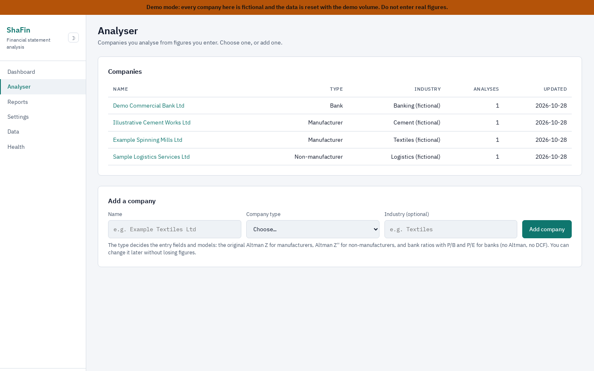
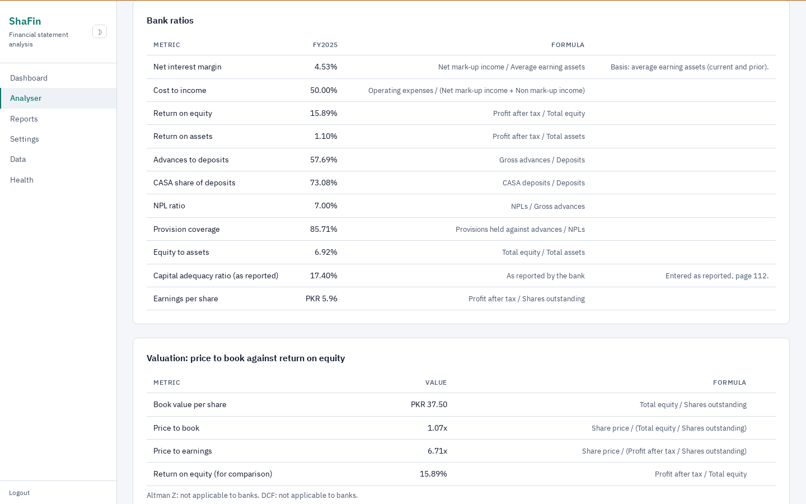
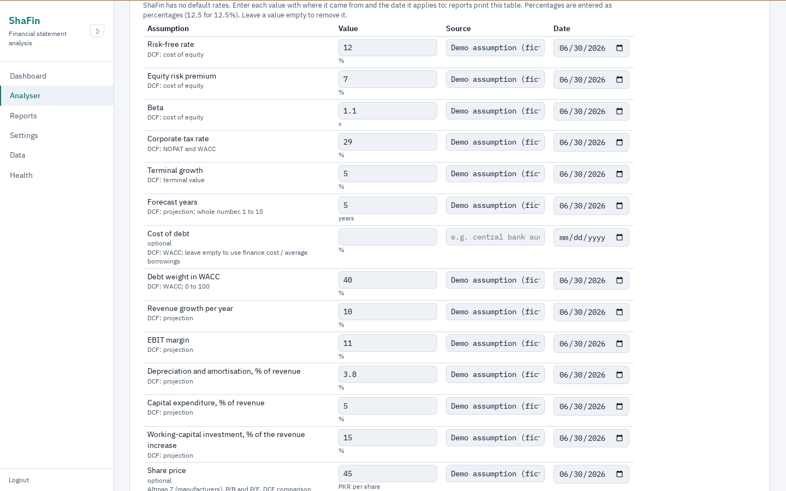
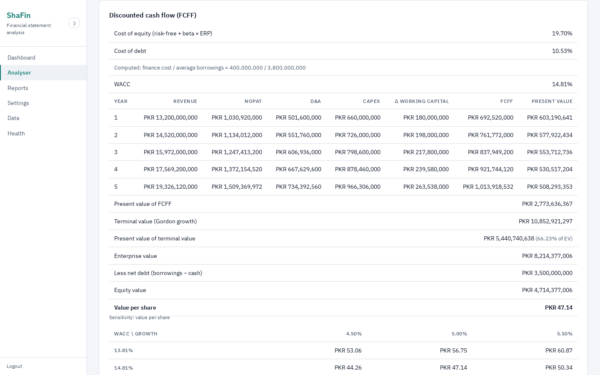
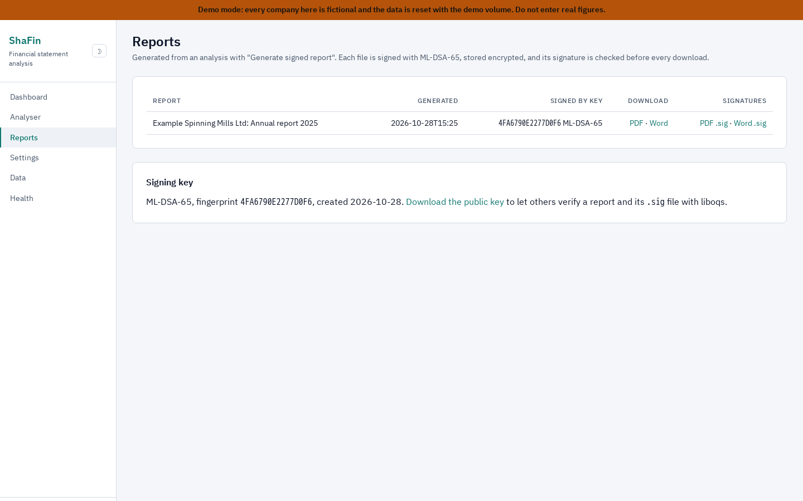
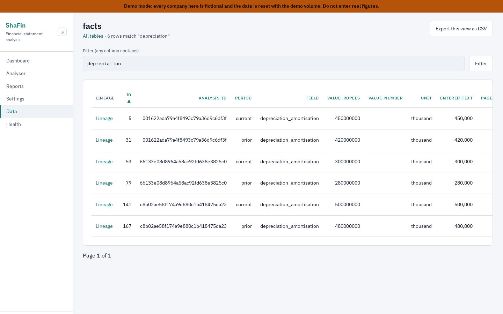
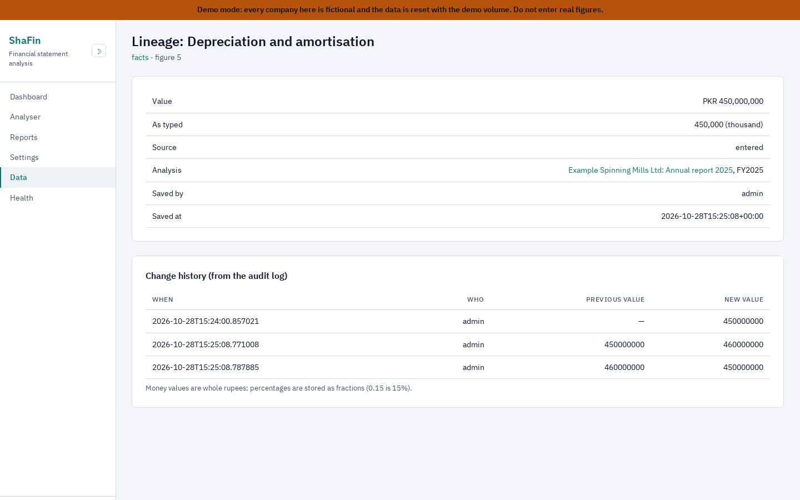
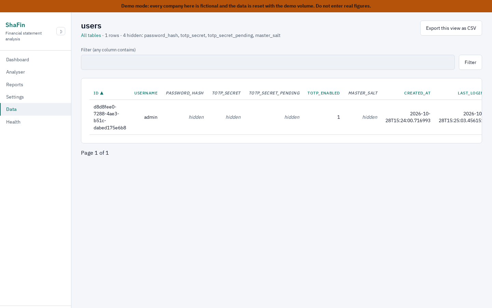
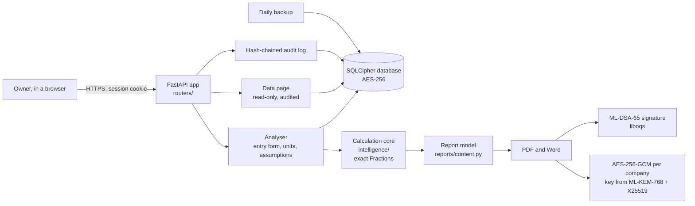

# ShaFin

Financial statement analysis from figures you enter. You type a company's figures from
its annual report, enter the assumptions the models need with their sources, and ShaFin
checks that the statements add up, computes ratios and models with exact arithmetic, and
produces reports signed with a post-quantum signature. Everything runs on your own
machine in Docker, in an encrypted database.

> **Not investment advice.** ShaFin computes what you ask it to from what you enter. It
> does not check figures against any source, and its output is not a recommendation to
> buy, sell or hold anything.



## Screenshots

From the demo (fictional companies), light theme.

| | |
|---|---|
|  **Bank analysis.** Flags against the owner's thresholds, the statement checks and the bank ratios; no Altman or DCF for banks. |  **Assumptions panel.** Every rate entered for this analysis, each with its source and date. |
|  **DCF.** Cost of capital, the year-by-year free cash flow, the value per share and the sensitivity grid. |  **Signed reports.** PDF and Word, signed with ML-DSA-65 and verified before every download. |
|  **Data page.** Every table, read-only, with a Lineage link for each figure. |  **Lineage.** Where a figure came from and every change to it, from the audit log. |
|  **Hidden columns.** Password hashes, TOTP secrets, session tokens, keys and encrypted columns are never selected and show as "hidden". | |

## What it does

- **Companies by type.** Each company is a manufacturer, a non-manufacturer or a bank. The
  type decides the entry fields and the models; changing it later keeps every figure.
- **Entry form with a unit selector.** Enter current and prior year figures in Rupees,
  Thousand, Lakh, Million, Crore or Billion, as the report states them. ShaFin shows the
  exact rupee value as you type and stores whole rupees. A figure that would need fractions
  of a rupee is refused, never rounded.
- **Assumptions per analysis.** No rate has a default. Risk-free rate, equity risk premium,
  beta, tax rate, terminal growth, forecast years, cost of debt and the projection drivers
  are entered for each analysis, each with a required source and date, and printed in its
  reports. A model with a missing assumption does not run; it says what it requires.
- **Checks.** Balance sheet, profit chain and cash flow identities, within one reporting unit.
- **Calculations** (defined once in [docs/CALCULATIONS.md](docs/CALCULATIONS.md)):
  - manufacturers and non-manufacturers: margins, returns, liquidity, leverage, coverage,
    turnover and working-capital days, DuPont, a profit bridge, Altman Z (manufacturers) or
    Z'' (non-manufacturers), and a free-cash-flow DCF with a sensitivity grid;
  - banks: NIM, cost to income, ROE, ROA, advances to deposits, CASA share, NPL ratio,
    coverage, equity to assets, CAR as reported, a profit bridge, and price to book beside
    ROE and price to earnings. No Altman and no DCF for banks.
- **Flags.** A threshold table in Settings, per company type, each threshold with its
  rationale and editable.
- **Signed reports.** PDF and Word, signed with ML-DSA-65, stored encrypted, and verified
  before every download. The signature files and the public key can be downloaded so
  anyone can verify a report.
- **The Data page.** Every table, read-only, for the owner with two-factor authentication;
  with a lineage page for each figure showing who entered it, when, and every change.
- **Backups.** An encrypted backup at every start and every night, with a SHA-256 sidecar.

## What it does not do

- It does not read PDFs or scan annual reports. Figures are typed in. (See Future work.)
- It makes no requests to any website: prices, rates and filings come from you. The tests
  run with networking disabled.
- It has no default rates, no fallback assumptions and no partial scores.
- It is single-owner: one account, on your machine.

## Quick start

You need Docker with Docker Compose.

```bash
cp .env.example .env
# Edit .env: set APP_SECRET_KEY (32+ characters) and DB_MASTER_PASSWORD (12+ characters).
# Keep DB_MASTER_PASSWORD safe: without it the database and its backups cannot be opened.
docker compose up --build
```

Open <https://localhost:8000> and accept the self-signed certificate. The first sign-in
creates the owner account with the password you choose; then turn on two-factor
authentication in Settings (the Data page needs it).

## Demo

```bash
docker compose -f docker-compose.demo.yml up --build
```

Open <https://localhost:8001> and sign in as `admin` with `shafin-demo-2026`. The demo
listens on port 8001 so it can run beside another service on 8000; choose any other port
with `SHAFIN_PORT`, for example `SHAFIN_PORT=8443 docker compose -f docker-compose.demo.yml up`
(PowerShell: `$env:SHAFIN_PORT=8443` first). The demo has
four fictional companies, entered as figures: Example Spinning Mills Ltd (manufacturer),
Sample Logistics Services Ltd (non-manufacturer), Demo Commercial Bank Ltd (bank) and
Illustrative Cement Works Ltd (a loss-making manufacturer, with its DCF assumptions left
out so you can see a model refuse to run). Their balance sheets balance and their profit
chains and cash flows add up. Every page shows a demo banner. The demo uses public demo
secrets and its own volume; never put real figures in it. Remove it with
`docker compose -f docker-compose.demo.yml down -v`.

## How it fits together



| Folder | What is in it |
|---|---|
| `routers/` | Web routes: auth, dashboard, analyser, reports, settings, data, health |
| `intelligence/` | Pure calculations: units, fields, ratios, bank, Altman, DCF, bridge, checks, flags |
| `database/` | Schema, companies, analyses and facts, thresholds, backups |
| `reports/` | Report model, PDF and Word rendering, signing, storage |
| `security/` | Sessions, passwords, encryption, post-quantum keys and signatures, audit log, TLS |
| `templates/`, `static/` | HTML, CSS, Chart.js and htmx (no CDN; everything is served locally) |
| `demo/` | The fictional demo companies and their loader |
| `tests/` | Tests; `tests/calculations/` holds the hand-computed vectors |

## What has been checked

Numbers from the last run of `scripts/check.sh` in a clean image with networking
disabled (the same command CI runs):

- **145** hand-computed calculation tests in `tests/calculations/`, one file per formula
  family, each with its working in a comment table: units, ratios, DuPont, Altman (every
  zone boundary of both variants), DCF (from the FCF build-up to the value per share, the
  sensitivity corners and the refusal when growth reaches WACC), bank ratios, the profit
  bridge, statement checks and flags. Comparisons are exact; there is no tolerance.
- **293** tests in total, including the Data page (read-only enforcement, hidden columns,
  table-name checking, audit entries), assumptions, company types, signed reports end to
  end, authentication, settings, backups and the fail-closed post-quantum checks.
- The profit bridge is also checked to sum exactly to the change in profit after tax for
  2,000 random sets of figures, and DuPont to multiply back to ROE for 500.
- ruff and vulture report nothing.

## Security

A summary; the details are in [docs/SECURITY.md](docs/SECURITY.md).

- **Post-quantum where it says so.** Reports are signed with **ML-DSA-65** (NIST FIPS 204),
  a post-quantum signature. Each company's report-encryption key is derived with a hybrid
  **ML-KEM-768 + X25519** key encapsulation combined with HKDF.
- **Classical where it is classical.** The database and its backups are encrypted with
  SQLCipher's **AES-256**, which is **not** a post-quantum algorithm. Report files are
  encrypted with AES-256-GCM. TLS uses a self-signed ECDSA certificate.
- **Fails closed.** Without liboqs, ML-KEM-768 or ML-DSA-65, ShaFin does not start. A wrong database password, a failed security
  self-test or undecryptable company key material stops it rather than degrading.
- **Owner only.** Argon2id password hashing, optional TOTP two-factor authentication
  (required for the Data page), sessions stored encrypted and bound to the device,
  login lockout, strict cookies and security headers.
- **Audited.** Logins, every change to a figure, assumption or threshold, every report and
  download, and every Data page view are written to a SHA-256 hash-chained audit log that
  Settings verifies.
- **Health.** `/healthz` is public and says only `ok`; `/health` needs the owner's login.

## Backups

ShaFin backs up the encrypted database at every start and daily at 01:00 (Pakistan time),
keeps the last 14 in `/app/data/backups` (inside the `shafin_data` volume), and writes a
SHA-256 file beside each. Set `BACKUP_COPY_DIR` to copy each backup to a second folder.

**Opening a backup read-only in DB Browser for SQLCipher.** Copy a backup out of the
volume, for example `docker cp shafin:/app/data/backups/shafin_<date>.db .`, then in
[DB Browser for SQLCipher](https://sqlitebrowser.org): *File, Open Database Read Only*,
choose the file, and when asked for the password choose *Passphrase*, enter your
`DB_MASTER_PASSWORD` and keep *SQLCipher 4 defaults* (ShaFin's image uses SQLCipher
4.6.1 with its default settings). Opening it read-only means nothing can be changed by
accident. To restore a backup instead, see [docs/RUNBOOK.md](docs/RUNBOOK.md).

## Roadmap

- **PDF pre-fill (scanner, experimental).** Read the statements from an annual report PDF
  and pre-fill the entry form, for the user to check and correct before anything is saved.
- **Excel and CSV import.** Load figures from a spreadsheet into the entry form, with the
  same unit conversion and checks as typed figures.
- **OCR for scanned reports.** Pre-fill from annual reports that are images rather than text.

## Development

```bash
docker build -t shafin:ci .
docker run --rm --network none \
  -e APP_SECRET_KEY=$(openssl rand -hex 32) -e DB_MASTER_PASSWORD=$(openssl rand -hex 16) \
  shafin:ci bash scripts/check.sh
```

`scripts/check.sh` runs the calculation tests, all tests, a template syntax check, ruff
and vulture. The tests use the real cryptography (liboqs, AES-GCM) in the image; any test
that opens a network connection fails. Python dependencies are pinned with hashes in
`requirements-ci.txt` (generated from `requirements-ci.in` with
`pip-compile --generate-hashes`). The image builds liboqs from a source tarball pinned by
SHA-256.

## Licence

Apache License 2.0; see [LICENSE](LICENSE). Third-party files and their licences are listed
in [NOTICE](NOTICE).
